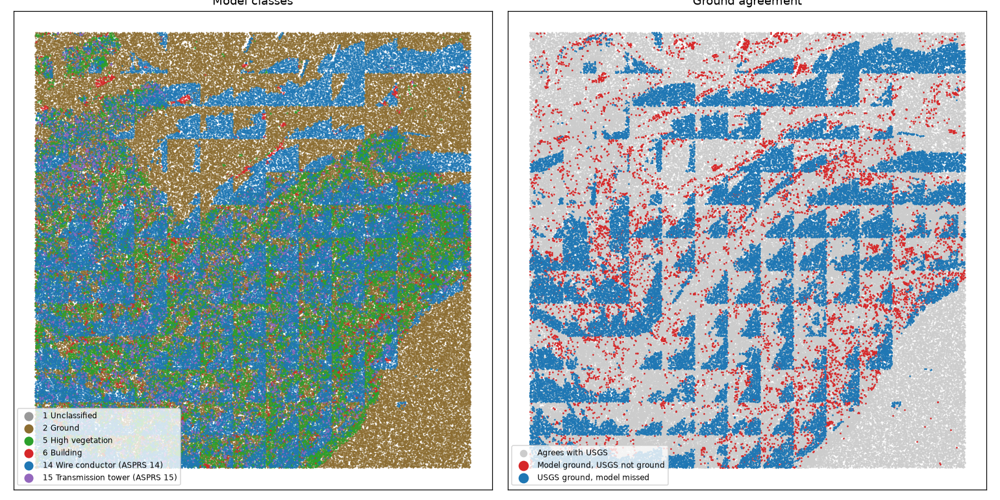
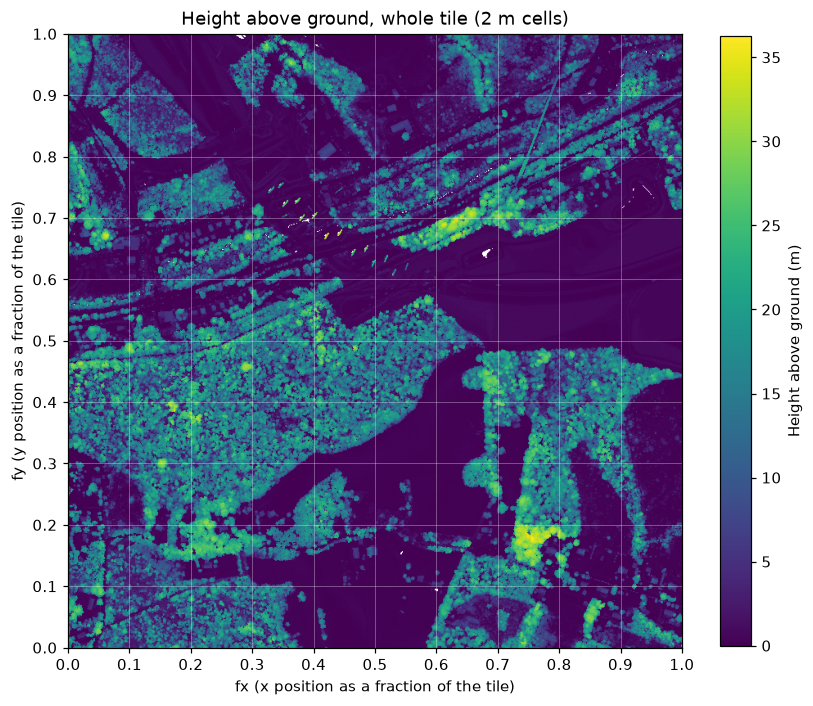
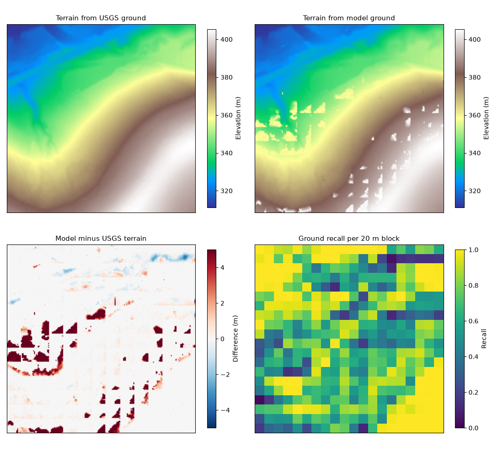
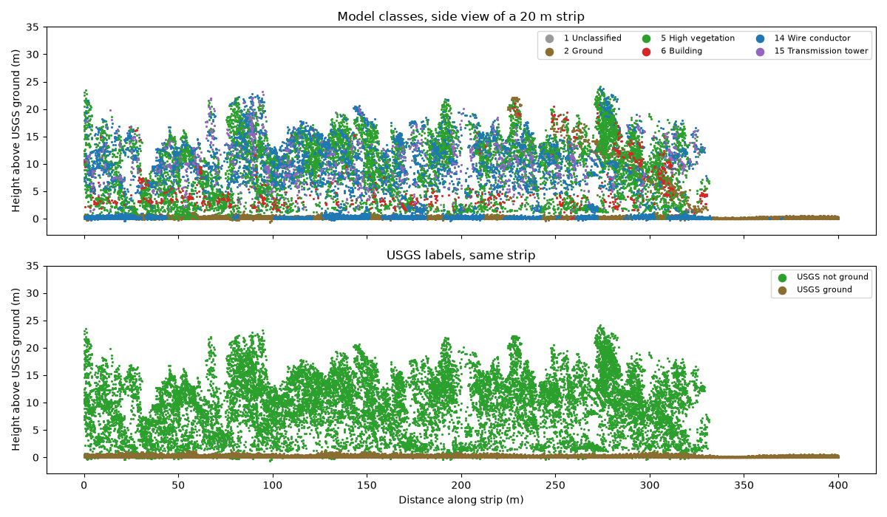
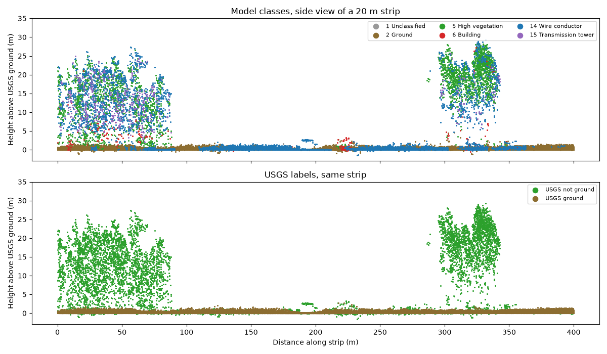

# Assessing a pretrained deep learning LiDAR classifier on forested airborne LiDAR

This project tests how well the SegFormer 3D Airborne (30 cm) model in the QGIS plugin LiDAR AI Classifier labels ground in a 400 m by 400 m forested crop of USGS airborne lidar, and what its mistakes do to a terrain model. I did not build the model or the plugin. The work here is the assessment.

## Why this project

I found the plugin author, Abderrazzaq Kharroubi, on LinkedIn, saw his announcement of version 1.2 (which added a mobile mapping LiDAR model), and decided to test the plugin myself. The mobile mapping model needs an NVIDIA GPU, which my setup does not have, so I tested the airborne SegFormer model, which runs on a CPU, on forested USGS airborne data and checked its output against the reference labels.

## Data

Point cloud: USGS 3DEP Lidar Point Cloud, project PA_WesternPA_2019_D20, tile 17TNE562467 (public domain), found through the USGS TNM Access API.

Crop: 400 m by 400 m, NAD83(2011) UTM zone 17N, X 563050 to 563450, Y 4467550 to 4467950. After removing USGS noise points (classes 7 and 18) it holds 771,201 points, about 4.8 points per square metre.

Reference labels: the USGS classification supplied with the tile. In this crop only ground (2) and unclassified (1) exist, so the assessment covers ground versus non ground only. There are no building or vegetation labels, so those classes cannot be scored. Vendor labels are a reference, not independent field truth.

Height above ground across the whole tile (the crop is the central 400 m):

## Model and setup

Plugin: LiDAR AI Classifier (package name Aerial LiDAR Classifier) version 1.2.1 on QGIS 3.44, by Abderrazzaq Kharroubi, GeoScITY Lab, University of Liege. Homepage: https://github.com/akharroubi/AerialLidarClassifier

Model: SegFormer 3D Airborne (30 cm), the UrbanFiltering 3D SegFormer from NRCan's TreeAIBox. Run on CPU inside a virtual machine with no GPU. The LitePT models need an NVIDIA GPU and were not tested. Model weights are licensed CC BY-NC 4.0, which allows non commercial use only.

Run time: about 5 hours on CPU in the virtual machine, by the author's own observation (an estimate of 5 h 23 min). The plugin's log line reported 16 h 00 min, which does not match, and a clock jump in the virtual machine is suspected.

Tiling: the option to process large files in spatial tiles was switched off for this run, because the crop is small (771,201 points).

## Method

1. find_tiles.py searches the USGS TNM Access API, inspect_las.py reports point counts and classes, overview_chm.py maps height above ground for the whole tile, and crop_tile.py cuts the test crop.
2. The classifier was run in QGIS on the crop.
3. phase3_assess.py compares the model's ground with the USGS ground and writes a confusion matrix and metrics.
4. phase4_terrain.py builds terrain models from the lowest ground point in each 2 m cell, once from USGS ground and once from model ground, fills gaps by linear then nearest neighbour interpolation, and compares them.
5. cross_section.py draws side views of 20 m strips.

## Results

Ground versus non ground, reference = USGS labels (771,201 points):

| Measure | Value |
|---|---|
| Overall accuracy | 0.790 |
| Ground precision | 0.916 |
| Ground recall | 0.712 |
| Ground F1 | 0.801 |
| IoU ground / non ground | 0.668 / 0.636 |
| Mean IoU | 0.652 |
| Cohen kappa | 0.586 |

Confusion counts: 326,536 ground found, 132,175 ground missed, 29,873 non ground called ground, 282,617 non ground correct.

Terrain from model ground compared with terrain from USGS ground (model minus USGS, 2 m cells):

| Cells | Count | Mean error | MAE | RMSE | Over 1 m | Over 2 m |
|---|---|---|---|---|---|---|
| Both have ground points | 32,663 | 0.37 m | 0.38 m | 2.19 m | 3.7% | 3.3% |
| Full terrain after gap filling | 40,401 | 0.58 m | 0.65 m | 2.64 m | 8.3% | 6.4% |
| Only cells where the model had no ground | 7,252 | 1.57 m | 1.88 m | 4.15 m | 28.6% | 20.4% |

The model had ground points in 81.0% of cells, USGS in 98.8%.

Model labels 14 (wire conductor) and 15 (transmission tower), split by what USGS says:

| Model class | Points | USGS ground | USGS not ground | Height of the non ground points (p10 / median / p90) |
|---|---|---|---|---|
| 14 | 208,552 | 128,484 (61.6%) | 80,068 | 1.1 / 10.7 / 19.2 m |
| 15 | 18,332 | 0 | 18,332 | 6.4 / 11.8 / 19.1 m |

Ground recall per 20 m block (400 blocks with at least 50 USGS ground points): under 0.2 in 4.5% of blocks, 0.2 to 0.8 in 51.5%, over 0.8 in 44.0%.

## Findings

- Where the model says ground it is usually right (precision 0.92), but it finds only 71% of the USGS ground (recall 0.71).
- 97% of the missed ground points (128,484 of 132,175) were labelled class 14, wire conductor, not vegetation or building.
- All 18,332 class 15 points and 80,068 class 14 points are non ground, with median heights of 10 to 12 m above ground. In the two side views they sit inside tree crown shaped clouds and no line or tower shaped structures are visible. This suggests canopy is being labelled as wires and towers, but the reference has no vegetation label, so it is an interpretation and not a measured error rate.
- Ground labelled class 14 appears under tree cover and also along stretches of open ground in the second strip, so the misses are not only a forest effect.
- Where both terrain models have ground, they agree closely (MAE 0.38 m). The weak spot is the 18% of cells where the model found no ground. There the error is larger (MAE 1.88 m, 20% of cells over 2 m off).
- The model's terrain reads higher than the USGS terrain on average (0.58 m after gap filling).
- The terrain differences form straight edged patches. The plugin's option to process large files in spatial tiles was switched off for this run, so that option does not explain them, and the cause was not determined.

## Limitations

- One 400 m crop from one forested, mostly rural tile. The results say little about the model in other landscapes.
- The reference is the data vendor's own classification, not field truth, and it only separates ground from everything else.
- Heights are measured above the USGS ground surface, so ground points sit near zero by construction.
- Terrain models use the lowest ground point per 2 m cell, which biases them low where ground points are dense and high where they are sparse.
- Only the CPU model was tested. A single run was made, so run to run variation is unknown.

## Reproducing this

Install laspy with the lazrs extra, numpy, scipy and matplotlib, run the plugin in QGIS on data/crop.laz, then run the scripts in the order listed under Method. The .laz files are not included in this repository. Run find_tiles.py with longitude and latitude -80.2515 40.3600 and download tile 17TNE562467.

## Credits and licence

Data: USGS 3DEP (public domain). Plugin and model: Abderrazzaq Kharroubi, GeoScITY Lab, University of Liege, and NRCan TreeAIBox. Figures and metrics in this repository were produced with model weights under CC BY-NC 4.0, so they are for non commercial use.
